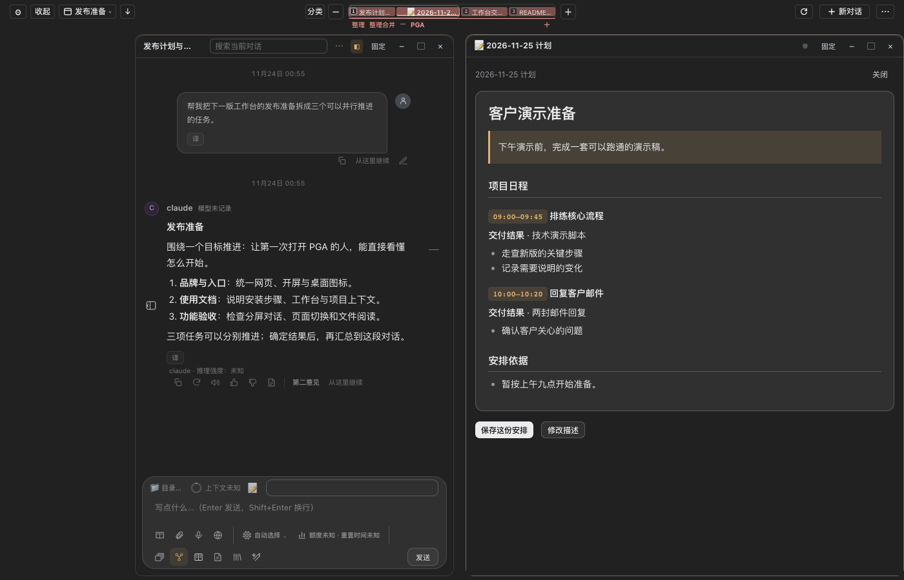

# 在 PGA 工作台列明日计划

**工作台 →「＋ 新对话」右边的「⋯」→「列明日计划」**。计划会作为一张页面开在当前对话旁边。使用 Mac 管理员浮窗时，可按 **⌘0** 进入完整版。

## 写一段话

新建的明日计划会直接显示「明天想做什么？」。已经有内容的计划，可以点页内的 **「AI 排程」**。用自己的话写明天想做什么，知道的约束也可以一起写。

> 明天下午三点给客户演示新版。上午想先跑通付款流程，再根据结果改演示稿。还有两封客户邮件要回，能在演示前处理就好。

点 **「生成项目安排」**。程序会拆出步骤、估算用时，把有依赖关系的工作排好先后。页面顶部是这一天要达成的目标，下方按时间展示每段工作的交付结果和具体行动。程序推定的条件列在「安排依据」，有冲突或排不下的事项列在「待安排」。

## 有补充就选，没有就保存

- **草案合适**，直接点 **「保存这份安排」**。所有补充题都可以跳过。
- **想调整一个细节**，在「可选补充」里只选你想回答的题，例如选择演示面向「技术团队」。点 **「按选择调整安排」**，看完新版再保存。
- **想改原话**，点 **「修改描述」**，改好后重新生成。点 **「关闭」** 可以放弃这次草案。

## 回看和编辑

保存后，计划页直接展示排好版的日程。点 **「编辑」** 可手动修改，正文自动保存。如果原计划已经有内容，采纳的新安排会接在后面。同一天在同一项目再次点「列明日计划」，会回到同一页；其他日期的安排可以从「计划」列表打开。[本机计划列表](http://127.0.0.1:8010/?view=notes)
